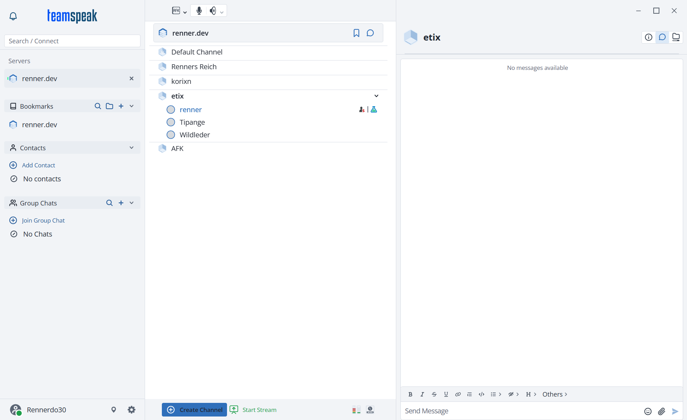
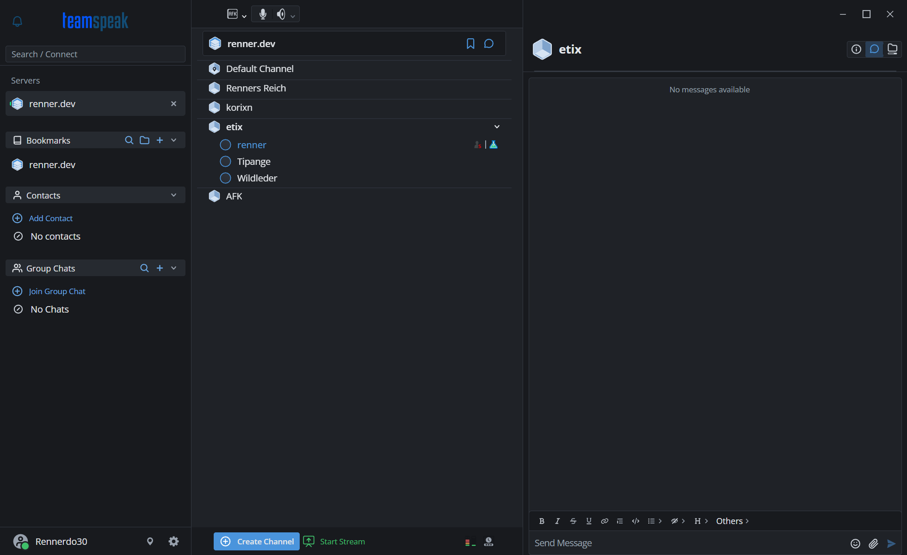
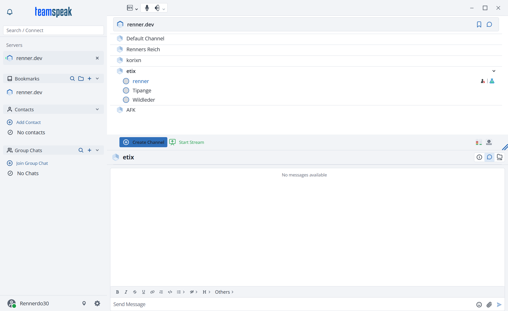

# Threespeak

A TeamSpeak 6 theme that brings back the calm of TeamSpeak 3: a dense channel
tree, flat surfaces, hairline borders and a single blue accent. One extension,
four variants.

| Variant | Layout |
| --- | --- |
| Threespeak Light | Tree left, chat or channel info on the right |
| Threespeak Dark | Same layout, dark palette |
| Threespeak Light, chat below | Tree on top, chat or channel info below it across the full width |
| Threespeak Dark, chat below | Same stacked layout, dark palette |







## Install

1. Download `dev.renner.threespeak.zip` from the
   [latest release](https://github.com/rennerdo30/threespeak/releases/latest)
   and extract it. You get a folder named `dev.renner.threespeak`.
2. Move that folder into the TeamSpeak extensions directory:
   - Windows: `%APPDATA%\TeamSpeak\Default\extensions`
   - Linux: `~/.config/TeamSpeak/Default/extensions`
   - macOS: `~/Library/Preferences/TeamSpeak/Default/extensions`
3. In the client open **Settings → Appearance → User Theme**, press the
   refresh button next to the theme picker and choose a Threespeak variant.
4. Restart the client once. The client reads the channel tree row heights only
   when the tree is first shown, so the dense 28px/24px rows appear after a
   restart. The same applies whenever you switch between Threespeak variants.

## What it changes

- Channel rows shrink to 28px, clients to 24px, with a hairline divider above
  every channel. Hover is a faint fill, the selected row gets a blue rule on
  the left, the channel you are in is shown bold.
- The large server card on top of the tree becomes a single 36px header row.
- Sidebar, headers and footers are one flat chrome grey with hairline borders.
  Gradients, pills, glows and the pulsing "Create a TeamSpeak Community"
  button are gone.
- Cards, inputs, menus and toggles have 3 to 4px corners and one-pixel borders.
- The chat log is a framed box with the input docked to its bottom edge.
- Type is Open Sans at 13px (bundled, with Segoe UI as fallback).

### Chat below

In the "chat below" variants the tree pane can be resized by dragging the blue
grip in its bottom-right corner (the browser's native resize handle; a theme
cannot add a full-width drag bar). The size resets when the client restarts.
The client renders only one detail pane at a time, so info, chat and files
share the bottom area.

## Develop

Sources live in `src/`; the files the client loads are generated.

| File | Purpose |
| --- | --- |
| `src/tokens-light.css` | Colour tokens for the light variants |
| `src/tokens-dark.css` | Colour tokens for the dark variants |
| `src/structure.css` | Layout, density and typography rules shared by all variants |
| `src/layout-stacked.css` | Extra rules appended for the "chat below" variants |
| `src/preview.template.svg` | Preview mockup, coloured from the tokens at build time |

```
node build.mjs            # writes threespeak-*.css and preview-*.svg
node build.mjs --verbose  # debug output; everything is logged to logs/build.log
```

The build inlines the Open Sans font files as data URIs. Extensions may not
load remote content, and the client serves theme files from a different origin
than the page, so a plain `url("fonts/…")` reference is refused by the
browser's cross-origin font rule.

To inspect the client's DOM while iterating, start it with a remote debugging
port and open the page listed at `http://localhost:9222/json` in Chrome:

```
"%LOCALAPPDATA%\Programs\TeamSpeak\TeamSpeak.exe" --remote-debugging-port=9222 --remote-allow-origins=*
```

## Known client behaviour

- Row heights are cached by the client when the tree first appears and never
  refreshed. Restart after selecting or switching a variant.
- A user theme is injected on top of the active built-in theme, so the theme
  overrides the client's CSS variables with `!important`.

## License

MIT for the theme, see [LICENSE](LICENSE). Open Sans is licensed under the
SIL Open Font License 1.1.
